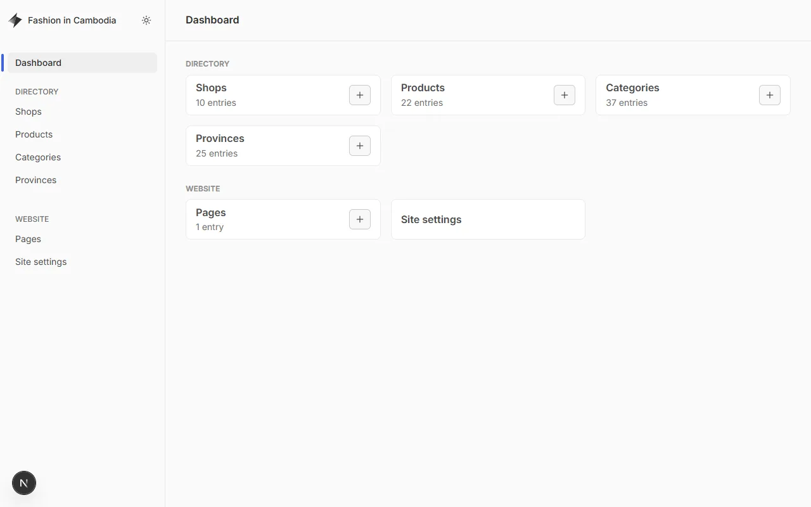
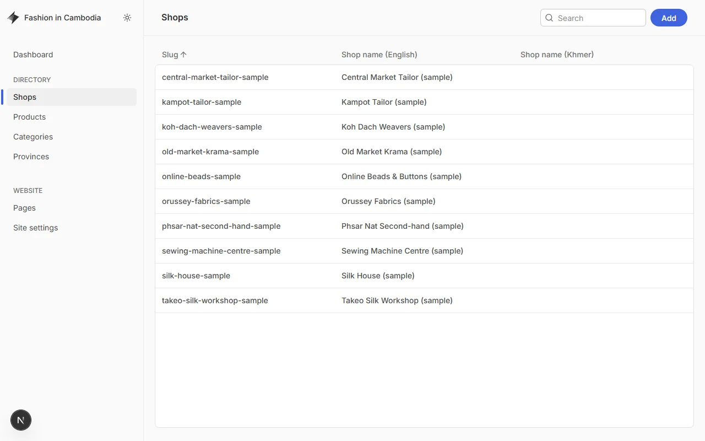
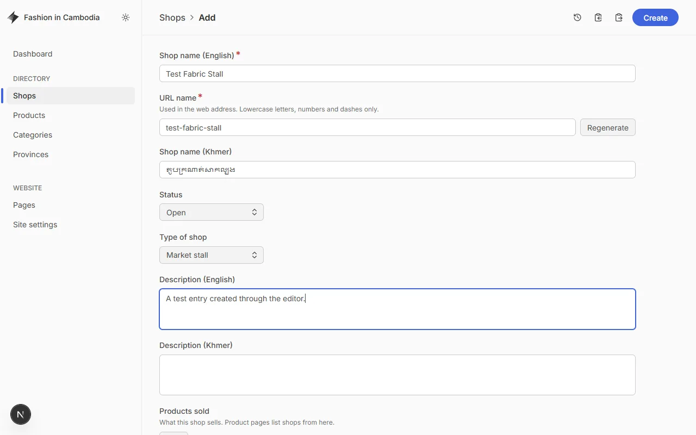
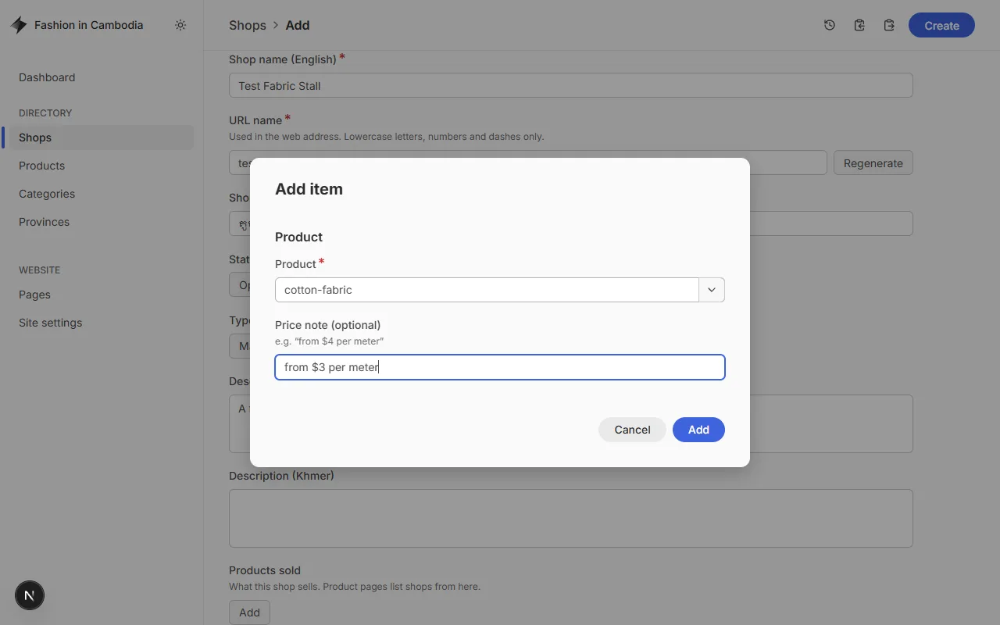
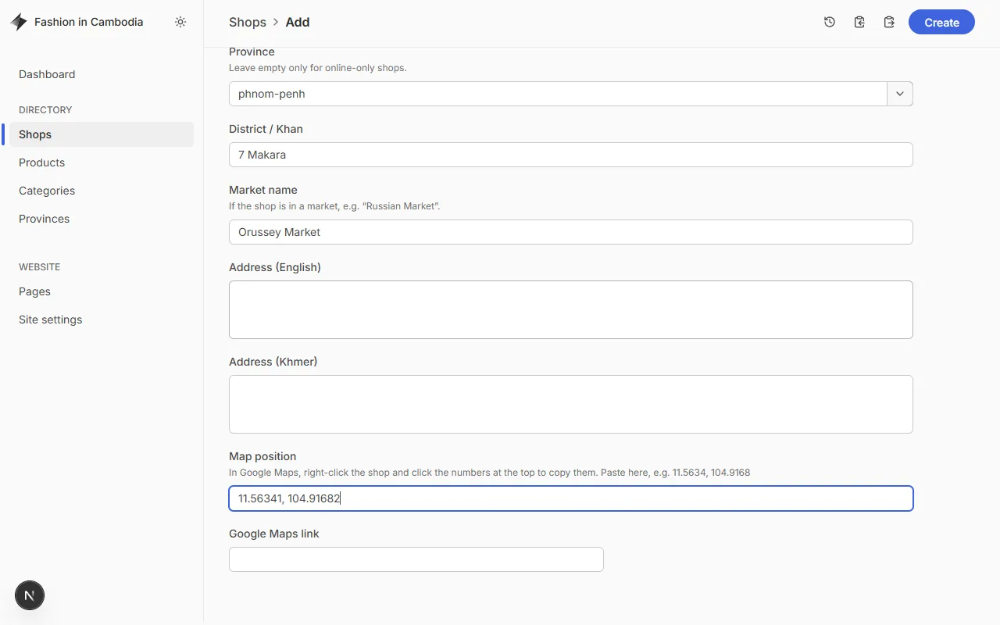
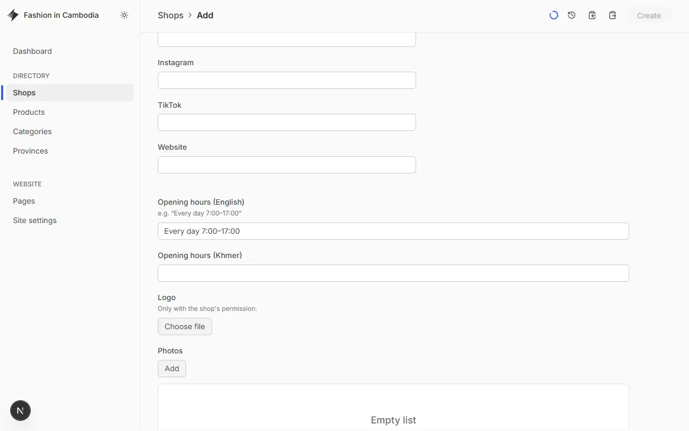

# Editor guide

How to add and update shops, products and other content using the
**Keystatic** editor. No coding needed.

> **Where to edit (for now):** the editor runs on a computer with the project
> installed — `pnpm dev`, then open <http://localhost:3000/keystatic>. From
> Phase 7, volunteers will edit on the live site with their GitHub account
> instead. Everything else in this guide stays the same.

---

## What you can edit



| Section           | What it is                                                                                                     |
| ----------------- | -------------------------------------------------------------------------------------------------------------- |
| **Shops**         | Shops, market stalls, workshops and online sellers. The heart of the directory.                                |
| **Products**      | _Types_ of things people look for — "Silk fabric", "Buttons", "Custom tailoring". Not single items with stock. |
| **Categories**    | Groups of products, two levels deep, e.g. _Fabrics & Textiles → Silk_.                                         |
| **Provinces**     | The 25 provinces, with the map position of each capital. Rarely changes.                                       |
| **Pages**         | Text pages such as _About_.                                                                                    |
| **Site settings** | Contact email, social media links, what the home page features.                                                |

Every entry has **English** (required) and **Khmer** (optional) fields. Fill in
Khmer whenever you can — the site shows it to Khmer readers and falls back to
English when it is empty.

---

## Add a shop

### 1. Open Shops and click Add



Search the list first, so you don't add a shop twice.

### 2. Name, type and description



- **Shop name (English)** — the name as written on the shop sign, in Latin
  letters. The **URL name** fills in by itself; leave it.
- **Shop name (Khmer)** — the Khmer name, if the shop has one.
- **Status** — _Open_ for normal shops.
- **Type of shop** — _Shop_, _Market stall_, _Workshop / tailor_ or _Online only_.
- **Description** — one or two plain sentences about what makes the shop
  useful. Facts, not advertising.

### 3. Products sold



Click **Add** under _Products sold_, pick a product and click **Add** in the
box. Repeat for each product.

- The product box shows each product's **URL name**, e.g. `cotton-fabric`.
  Type part of the name (`cotton`, `button`, `silk`) to find it.
- **Price note** is optional, e.g. "from $3 per meter".
- If the product does not exist yet, save the shop first, add the product
  under **Products**, then come back.

The product's page on the website lists every shop that sells it — you only
add the link here, on the shop.

### 4. Location



- **Province** — type part of the name in lowercase, e.g. `phnom`, `siem`,
  `battam`. Leave empty only for online-only shops.
- **District / Khan** and **Market name** (if the shop is in a market).
- **Address** — as precise as you can: street, house number, stall number.
- **Map position** — needed for the map:
  1. Open [Google Maps](https://maps.google.com) and find the shop.
  2. **Right-click** the exact spot (on a phone: press and hold).
  3. Click the numbers at the top of the menu, e.g. `11.56341, 104.91682` —
     they are copied.
  4. Paste them into **Map position**.
- **Google Maps link** — optional: the shop's "Share" link from Google Maps.

### 5. Contact, opening hours and photos



- **Phone numbers** — Cambodian numbers only, e.g. `012 345 678` or
  `+855 12 345 678`. Only the shop's **business** numbers.
- **Telegram** — username without `@`, or the phone number used on Telegram.
- **Facebook / Instagram / TikTok / Website** — full links starting with
  `https://`.
- **Opening hours** — e.g. "Every day 7:00–17:00" or "Mon–Sat 8:00–18:00".
- **Logo** — only with the shop's permission.
- **Photos** — see [Photos](#photos) below. Every photo needs a short
  description for people who cannot see it.

### 6. Verified, then save

- Tick **Verified** only after you **visited, called, or confirmed with the
  owner**, and set **Last verified on** to that date.
- Leave **Sample entry** unticked — it is only for example data.
- Click **Create** (top right). For an existing shop the button is **Save**.

The shop is saved as a file in `content/shops/<url-name>/index.yaml`.

---

## Update or close a shop

- Changed phone, hours or products → open the shop, edit, **Save**, and update
  **Last verified on** if you confirmed it.
- Closed for a while → **Status: Temporarily closed**.
- Closed for good → **Status: Permanently closed**. Do **not** delete the
  shop: keeping it stops someone adding it again by mistake. Closed shops are
  hidden from the website.

---

## Products, categories and provinces

- **Product** — name, **category** (pick the most specific one, e.g. _Silk_,
  not _Fabrics & Textiles_), description, **search keywords** (other names
  and spellings people use, in any language — "krama", "kroma", "ក្រមា"),
  _Made in Cambodia_, and an optional typical price.
- **Category** — leave **Parent category** empty for a top-level category.
  Categories go only two levels deep.
- **Provinces** — all 25 exist already. Only change a map position if it is
  clearly wrong.

---

## Photos

- Use **your own photos**, or photos the owner gave you permission to use.
  Never copy photos from Facebook, Google Maps or websites.
- All photos are published under
  [CC BY-SA 4.0](../CONTENT_LICENSE.md) — anyone may reuse them with credit.
- No faces of people who did not agree to be photographed.
- Upload the photo as it is; a maintainer (or the project checks) will shrink
  it. Developers: run `pnpm images` to convert new photos to WebP, at most
  1600 px wide.

---

## Before publishing (maintainers)

Run the checks that CI also runs:

```bash
pnpm check:content
```

It reports broken links between entries (a shop selling a product that does
not exist, an unknown province), map positions outside Cambodia, verified shops
without a date, and anything that does not match the editor's rules.

```bash
pnpm images:check
```

It lists photos that still need converting.

---

## Writing tips

- Short, plain sentences. Many readers use a phone and read in their second
  language.
- Write the Khmer text yourself rather than using machine translation when
  you can, and ask a native speaker to check it.
- Don't include private information: no personal phone numbers or home
  addresses, only the shop's public business details.
